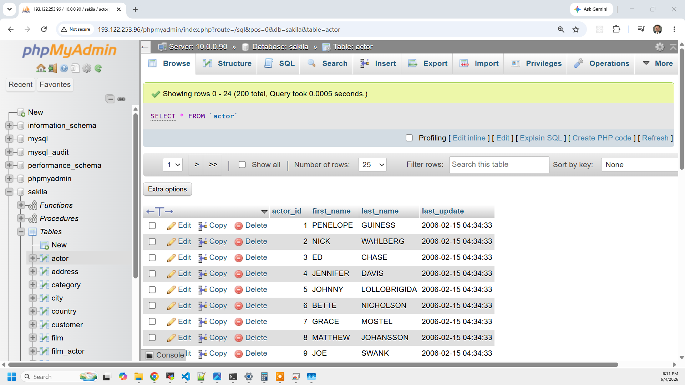
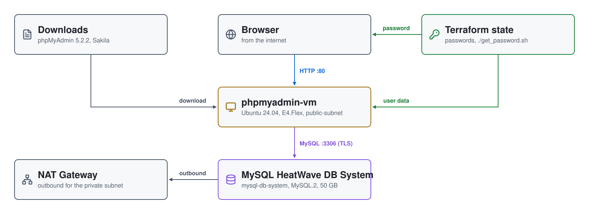
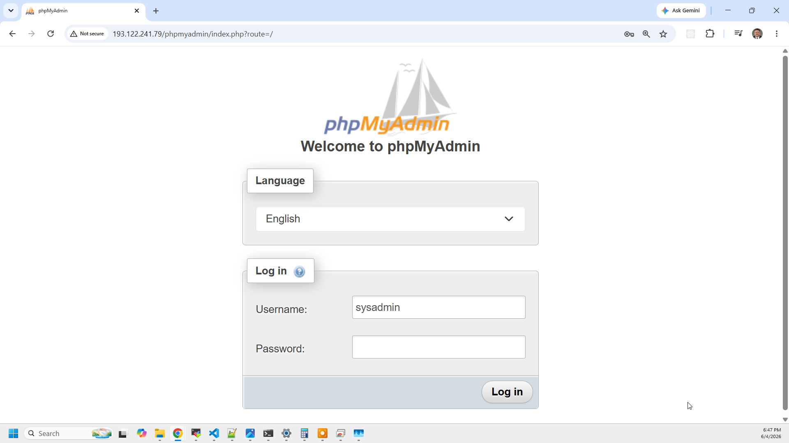

# MySQL on OCI: MySQL HeatWave DB System with phpMyAdmin

A private **MySQL HeatWave DB System**, built with Terraform and loaded with
the [Sakila](https://dev.mysql.com/doc/sakila/en/) sample database. The DB
System has no public endpoint; a **phpMyAdmin** VM in a public subnet gives
you a browser client for it.



| Piece | Where | Role |
|---|---|---|
| **MySQL HeatWave DB System** | `private-subnet` (10.0.0.0/25) | `mysql-db-system`, shape `MySQL.2`, 50 GB, 7-day backups, admin `sysadmin`; no public endpoint |
| **phpmyadmin-vm** | `public-subnet` (10.0.1.0/25) | Ubuntu 24.04, `VM.Standard.E4.Flex` (1 OCPU, 4 GB); loads Sakila, then serves phpMyAdmin 5.2.2 |
| **NAT gateway** | `private-subnet` route | outbound internet for the DB System |
| **Internet gateway** | `public-subnet` route | inbound and outbound for the VM |
| **Terraform state** | `01-mysql/terraform.tfstate` | the MySQL and VM passwords, as sensitive outputs; OCI Vault isn't used |

## Architecture

<picture>
  <source media="(prefers-color-scheme: dark)" srcset="architecture-dark.svg">
  
</picture>

Regenerate with `python3 make_diagram.py`.

- **`01-mysql/`** is the whole stack: the VCN (`mysql-vcn`, 10.0.0.0/23) with
  its internet and NAT gateways, a route table and security list per subnet,
  the DB System, the SSH key and passwords, and the phpMyAdmin VM.

## How it boots

1. Terraform builds the VCN, generates an ECDSA SSH key
   (`01-mysql/keys/Private_Key`) and two passwords, and creates the DB System.
   The DB System usually takes 10–20 minutes.
2. The VM's cloud-init script waits for outbound internet, forces apt onto
   IPv4, retries `apt-get update` until the boot-time apt lock clears, and
   opens port 80 in the image's iptables rules, which reject it by default.
   It also sets the `ubuntu` user's password.
3. It installs Apache, PHP and the MySQL client, downloads phpMyAdmin 5.2.2,
   and points it at the DB System's private IP over TLS (`ssl = true`,
   certificate not verified). `/` redirects to `/phpmyadmin`.
4. It downloads Sakila from dev.mysql.com and loads it with
   `--ssl-mode=REQUIRED`, then creates phpMyAdmin's own configuration tables
   in a `phpmyadmin` database. Everything logs to `/root/userdata.log`.

## Security lists

```
internet ─80, 22─▶ phpmyadmin-vm (public-subnet) ─3306─▶ DB System (private-subnet)
```

| Security list | Subnet | Allows |
|---|---|---|
| `mysql-vm-sl` | `public-subnet` | 80 and 22 from anywhere |
| `mysql-sl` | `private-subnet` | 3306 from `public-subnet` (10.0.1.0/25) only |

Both allow all outbound traffic.

## Prerequisites

* [An OCI Account](https://cloud.oracle.com/)
* [Install OCI CLI](https://docs.oracle.com/en-us/iaas/Content/API/SDKDocs/cliinstall.htm),
  configured with a `DEFAULT` profile in `~/.oci/config`
* [Install Terraform](https://developer.hashicorp.com/terraform/install)
* [Install jq](https://jqlang.github.io/jq/download/)

## Deploy

```bash
git clone https://github.com/mamonaco1973/oci-mysql.git
cd oci-mysql
export OCI_COMPARTMENT_ID=<compartment-ocid>   # optional; defaults to the tenancy
./apply.sh       # one phase: VCN, DB System, phpMyAdmin VM
```

Everything deploys to `us-ashburn-1`, in the first availability domain.
`apply.sh` ends by running `validate.sh`, which waits for phpMyAdmin to
answer (up to 15 minutes) and prints:

```
================================================================================
BUILD VALIDATION RESULTS
================================================================================
phpMyAdmin URL  : http://203.0.113.10
MySQL Private IP: 10.0.0.90
Credentials     : ./get_password.sh
================================================================================
```

## Try it

1. Get the passwords:

   ```bash
   ./get_password.sh
   ```

   ```
   MySQL (HeatWave DB System):
     Username : sysadmin
     Password : <generated>
     Host     : 10.0.0.90 (private)

   phpMyAdmin VM:
     Username : ubuntu
     Password : <generated>
     Public IP: 203.0.113.10
     URL      : http://203.0.113.10
   ```

2. Open the phpMyAdmin URL and sign in as `sysadmin`:

   

3. The `sakila` database is in the tree on the left. Run the sample queries
   from the **SQL** tab:

   ```sql
   SELECT
       f.title AS film_title,
       CONCAT(a.first_name, ' ', a.last_name) AS actor_name
   FROM sakila.film f
   JOIN sakila.film_actor fa ON f.film_id = fa.film_id
   JOIN sakila.actor a ON fa.actor_id = a.actor_id
   ORDER BY f.title, actor_name
   LIMIT 20;
   ```

   ```sql
   SELECT
       f.title,
       GROUP_CONCAT(
           CONCAT(a.first_name, ' ', a.last_name)
           ORDER BY a.last_name
           SEPARATOR ', '
       ) AS actor_names
   FROM sakila.film f
   JOIN sakila.film_actor fa ON f.film_id = fa.film_id
   JOIN sakila.actor a ON fa.actor_id = a.actor_id
   GROUP BY f.title
   ORDER BY f.title
   LIMIT 10;
   ```

## Troubleshooting

| Symptom | Fix |
|---|---|
| `validate.sh` keeps retrying | The VM is still installing. `ssh -i 01-mysql/keys/Private_Key ubuntu@<public-ip>`, then `sudo tail /root/userdata.log`. |
| The URL times out although Apache is running | Port 80 must be allowed ahead of the image's REJECT rule: `sudo iptables -L INPUT -n --line-numbers`. |
| `sakila` is missing | Look for `mysql` errors near the end of `/root/userdata.log`. |
| You want a local client | The DB System is private. Connect from the VM: `mysql -h <mysql-ip> -u sysadmin -p --ssl-mode=REQUIRED`. |

## Teardown

```bash
./destroy.sh     # destroys the whole stack
```

## Notes

- **Lab only.** phpMyAdmin is open to the internet over plain HTTP, SSH is
  open from anywhere, and the passwords are in Terraform state and the VM's
  user data. Restrict `mysql-vm-sl` and add TLS for anything more.
